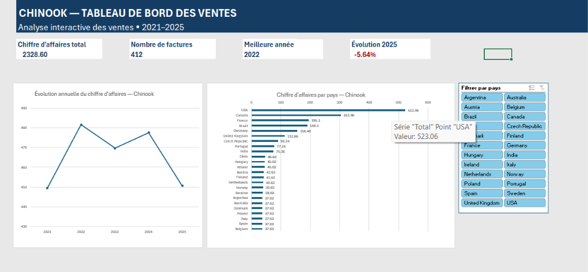

# Analyse commerciale de Chinook — SQL, Python, Power BI & Excel

## Présentation

Ce projet de Data Analytics repose sur la base de données relationnelle Chinook, représentant les ventes d'un magasin de musique.

L'objectif est d'exploiter les données commerciales pour analyser les ventes, identifier les principaux marchés, étudier les comportements d'achat et construire des tableaux de bord interactifs facilitant l'interprétation des résultats.

Le projet combine quatre outils complémentaires : **SQL, Python, Power BI et Excel**.

## Outils et technologies

- **SQL / SQLite** : extraction, jointures, agrégations et calcul d'indicateurs.
- **Python / Pandas** : manipulation, exploration et traitement des données.
- **Matplotlib** : visualisation des résultats.
- **Jupyter Notebook** : documentation des analyses.
- **Power BI / Power Query / DAX** : modélisation, création de mesures et tableaux de bord interactifs.
- **Microsoft Excel 365** : tableaux croisés dynamiques, formules statistiques, KPI, graphiques et segments interactifs.

## Analyses réalisées

### 1. SQL et Python

1. Calcul du nombre total de clients.
2. Répartition géographique des clients.
3. Analyse du chiffre d'affaires par pays.
4. Calcul du montant moyen des factures par pays.
5. Identification des 10 clients générant le plus de chiffre d'affaires.
6. Analyse du nombre de factures et des montants facturés par client.
7. Analyse du chiffre d'affaires par genre musical.
8. Création de graphiques avec Matplotlib et interprétation des résultats.

### 2. Power BI — Tableau de bord interactif

Création d'un tableau de bord permettant de visualiser les performances commerciales.

**Fonctionnalités :**
- Analyse du chiffre d'affaires par pays et par genre musical.
- Visualisation de l'évolution mensuelle des ventes.
- Création de KPI.
- Filtrage dynamique par année.
- Modélisation des relations entre Invoice, InvoiceLine, Track et Genre.
- Création de mesures DAX.

**Fichier :** `Chinook.pbix`

### 3. Excel — Analyse et Dashboard interactif

Développement d'un tableau de bord Excel à partir de 412 factures extraites de la base Chinook.

**Travaux réalisés :**
- Importation de fichiers CSV.
- Préparation et organisation des données.
- Utilisation des fonctions SOMME, MOYENNE, MAX, MIN, NB et SOMME.SI.
- Calcul de pourcentages, d'écarts-types et de taux d'évolution.
- Création de tableaux croisés dynamiques.
- Analyse du chiffre d'affaires par pays et par année.
- Création de graphiques de comparaison et d'évolution.
- Mise en place d'un filtre interactif par pays.
- Création de quatre KPI dynamiques : chiffre d'affaires, nombre de factures, meilleure année et évolution annuelle.

**Fichier :** `Chinook_Sales_Dashboard_Excel.xlsx`

## Principaux résultats

| Indicateur | Résultat |
|---|---:|
| Nombre total de clients | 59 |
| Nombre de factures | 412 |
| Chiffre d'affaires total | 2 328,60 |
| Pays générant le plus de chiffre d'affaires | USA |
| Chiffre d'affaires des USA | 523,06 |
| Part des USA dans le chiffre d'affaires | 22,46 % |
| Genre musical dominant | Rock |
| Chiffre d'affaires du Rock | 826,65 |
| Meilleure année | 2022 |
| Évolution du chiffre d'affaires en 2025 | −5,64 % |

Les montants sont exprimés dans l'unité monétaire de la base, sans présumer d'une devise.

## Aperçu des tableaux de bord

### Power BI

### Excel

## Reproduire le projet

1. Télécharger les fichiers du dépôt.
2. Placer `chinook.sqlite` dans le même dossier que `Analyse_commerciale_Chinook.ipynb`.
3. Ouvrir le notebook dans Jupyter.
4. Exécuter les cellules dans l'ordre.
5. Ouvrir `Chinook.pbix` dans Power BI Desktop pour explorer le tableau de bord Power BI.
6. Ouvrir `Chinook_Sales_Dashboard_Excel.xlsx` dans Excel pour explorer les indicateurs et les filtres interactifs.

**Bibliothèques Python :** `sqlite3`, `pandas`, `matplotlib`.

## Limites

Chinook est une base de données de démonstration.

Les analyses portent sur le chiffre d'affaires facturé et non sur les bénéfices, car les données ne comprennent pas les coûts commerciaux.

Les résultats décrivent les ventes observées et ne permettent pas, à eux seuls, d'expliquer les causes des variations commerciales.

## Source des données

[Chinook Database — dépôt de référence](https://github.com/lerocha/chinook-database)
