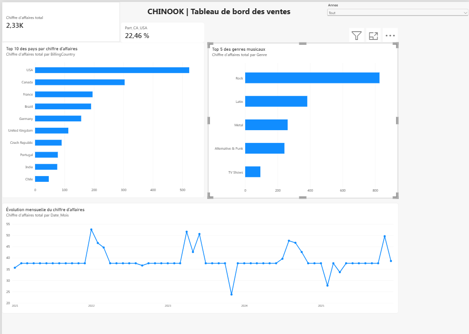

# Analyse commerciale de Chinook — Projet SQL

## Présentation

Ce projet de Data Analytics explore une base relationnelle de démonstration représentant les ventes d’un magasin de musique. L’objectif est de répondre à des questions commerciales à l’aide de requêtes SQL, puis de présenter les résultats sous forme de tableaux et de graphiques.

## Outils

- **SQLite / SQL** : extraction, jointures et calcul d’indicateurs.
- **Python et pandas** : récupération et exploration des résultats SQL.
- **Matplotlib** : visualisation des données.
- **Jupyter Notebook** : documentation et restitution des analyses.

## Analyses réalisées

1. Nombre total de clients.
2. Répartition des clients par pays.
3. Chiffre d’affaires par pays.
4. Montant moyen des factures par pays.
5. Dix clients générant le plus de chiffre d’affaires.
6. Nombre de factures et montant total par client.
7. Chiffre d’affaires par genre musical.
8. Trois graphiques et synthèse des résultats.

## Principaux résultats

- **59 clients** dans la base.
- Les **États-Unis** comptent le plus de clients (13) et génèrent le chiffre d’affaires le plus élevé (523,06).
- Le **Rock** est le genre ayant le chiffre d’affaires le plus élevé (826,65).
- **Helena Holý** arrive en tête des clients selon le montant total facturé (49,62).

*Les montants sont exprimés dans l’unité monétaire de la base, sans présumer d’une devise.*

## Reproduire le projet

1. Télécharger les fichiers de ce dépôt.
2. Placer `chinook.sqlite` dans le **même dossier** que `Analyse_commerciale_Chinook.ipynb`.
3. Ouvrir le notebook avec Jupyter, dans ce dossier.
4. Exécuter les cellules dans l’ordre, de haut en bas.

Bibliothèques Python utilisées : `sqlite3` (bibliothèque standard), `pandas`, `matplotlib`.

## Structure

```text
Projet_SQL_Chinook/
├── Analyse_commerciale_Chinook.ipynb
├── chinook.sqlite
└── README.md
```

## Limites

Chinook est une base de démonstration. Le projet mesure le chiffre d’affaires (ventes facturées), **pas les bénéfices**, puisqu’il ne dispose pas des coûts. Le nombre de factures n’est pas à lui seul une mesure de fidélité.
## Tableau de bord Power BI

Le projet a été enrichi par la création d'un tableau de bord interactif permettant d'analyser les ventes de la base Chinook.

### Fonctionnalités réalisées

- Analyse du chiffre d'affaires par pays et par genre musical.
- Visualisation de l'évolution mensuelle des ventes.
- Création d'indicateurs KPI, notamment le chiffre d'affaires total et la contribution des États-Unis.
- Filtrage dynamique des résultats par année.
- Modélisation des relations entre les tables Invoice, InvoiceLine, Track et Genre.
- Création de mesures DAX pour calculer les indicateurs.

### Principaux résultats

- **Chiffre d'affaires total :** 2 328,60.
- **Premier marché :** États-Unis, avec environ 22,46 % du chiffre d'affaires.
- **Genre musical dominant :** Rock.

### Outils utilisés

SQL, SQLite, Python, Pandas, Matplotlib, Power Query, DAX et Power BI.

### Fichier Power BI

Le fichier `Chinook.pbix` contient le tableau de bord interactif et peut être ouvert avec Power BI Desktop.
## Aperçu du tableau de bord Power BI


## Source des données

[Chinook Database — dépôt de référence](https://github.com/lerocha/chinook-database)
